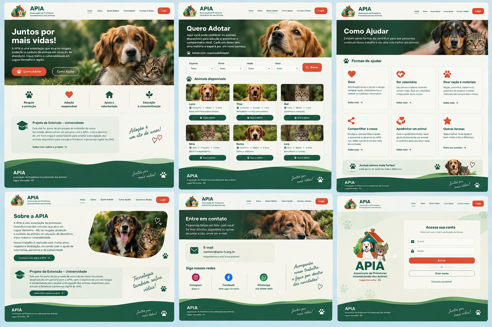

# Plataforma Web da APIA

**Instituição:** IFSUL  
**Curso:** Bacharelado em Ciência da Computação  
**Disciplina:** Práticas em Sociedade III  
**Discentes:** Daniel Cipriano da Silva e Gabriel de Oliveira  
**Docente orientadora:** Prof. Carmem Vera Scorsatto  
**IFSUL - Ciência da Computação**

Plataforma web institucional para a **APIA — Associação de Protetores Independentes dos Animais**, de Lagoa Vermelha, Rio Grande do Sul. O projeto será desenvolvido como atividade de extensão curricular, com acompanhamento do orientador e evolução registrada em commits semanais.

> Este README consolida os requisitos levantados com a ONG e apresenta uma proposta inicial de organização. Tecnologias, prioridades e detalhes de implementação poderão ser definidos em conjunto com o orientador e a diretoria durante o desenvolvimento.

## Mockup da plataforma



## Objetivos

- Apresentar a ONG, seu trabalho e formas de apoiar a causa animal.
- Divulgar animais disponíveis para adoção e facilitar o primeiro contato pelo WhatsApp.
- Manter o histórico de animais adotados em uma seção de finais felizes.
- Reunir informações sobre voluntariado, pontos de coleta, eventos e contatos oficiais.
- Permitir que a equipe gerencie o conteúdo pelo celular.

## Requisitos levantados

### Adoção de animais

- O botão **Quero Adotar** deve iniciar uma conversa com a ONG pelo WhatsApp, com uma mensagem automática preenchida.
- Antes do contato, o site deve informar os requisitos para adoção:
  - preferência por residência com pátio fechado;
  - assinatura obrigatória do Termo de Responsabilidade;
  - a pessoa adotante deve ser maior de idade.
- O perfil de cada animal deve apresentar, no mínimo, nome, foto, espécie e porte, além de informar expressamente se está castrado e vacinado.
- Animais adotados não devem simplesmente desaparecer do site: devem poder ser registrados na seção **Finais Felizes**, com fotos e informações da adoção.

### Como ajudar e apoio à ONG

- Divulgar as formas de contribuição e os pontos físicos de coleta de ração:
  - **Miagro Agrícola:** Rua Lauro Júlio Garcez, 327, Alto Pedregal.
  - **Mercado de Bone:** Avenida Afonso Pena, 223, Centro.
  - **Agropecuária Amor a Terra:** Avenida Benjamin Constant, 2291, Centro.
- Disponibilizar um formulário próprio para cadastro de pessoas interessadas em ser voluntárias.
  - No frontend atual, o formulário prepara uma mensagem e encaminha a pessoa para o WhatsApp; os dados não são persistidos pela API.

### Painel administrativo

- O painel deve ser otimizado para smartphones, pois a administração do site será feita principalmente pelo celular.
- A equipe autorizada deverá conseguir gerenciar os conteúdos necessários, como animais, finais felizes e eventos, por uma interface simples e responsiva.

### Eventos e contatos oficiais

- Criar uma área para divulgar datas e informações de eventos e ações, como bazares solidários e feirinhas de adoção.
- Apresentar no rodapé as redes sociais oficiais:
  - **Instagram:** confirmar com a ONG o perfil oficial antes da publicação; o frontend atual exibe `@ongapia.oficial`.
  - **Facebook:** APIA Proteção Animal (confirmar com a ONG o endereço oficial da página antes da publicação).

## Estrutura de páginas

1. **Início** — apresentação da APIA, chamadas para adoção e formas de ajudar, destaques de animais e próximos eventos.
2. **Sobre a APIA** — história, missão, atuação e informações do projeto de extensão.
3. **Quero Adotar** — lista e filtros de animais disponíveis, requisitos de adoção e acesso aos perfis.
4. **Perfil do animal** — fotos, nome, espécie, porte, informações de saúde (castrado e vacinado), descrição e botão de contato pelo WhatsApp.
5. **Finais Felizes** — galeria e registros de animais adotados.
6. **Como Ajudar** — formas de contribuição, pontos de coleta com endereço e formulário de voluntariado.
7. **Eventos e ações** — agenda e informações de bazares, feirinhas e outras atividades.
8. **Contato** — canais de contato e redes sociais oficiais.
9. **Acesso administrativo** — entrada restrita para a equipe responsável pelo gerenciamento do conteúdo.
10. **Painel administrativo** — área privada e adaptada para celular para cadastrar e atualizar animais, adoções, eventos e demais conteúdos definidos pela ONG.

## Organização técnica proposta

A separação abaixo é uma referência para organizar o repositório. A estrutura e as tecnologias podem ser ajustadas depois da validação do escopo.

```text
apia-plataforma/
├── frontend/                 # Interface pública e painel administrativo
│   ├── src/
│   │   ├── components/        # Componentes reutilizáveis
│   │   ├── pages/             # Páginas e rotas
│   │   ├── services/          # Comunicação com API e serviços externos
│   │   ├── styles/            # Estilos e identidade visual
│   │   └── assets/            # Imagens, ícones e outros arquivos
│   └── public/                # Arquivos estáticos públicos
├── backend/                   # API, regras de negócio e autenticação
│   ├── src/
│   │   ├── routes/            # Rotas da API
│   │   ├── controllers/       # Tratamento das requisições
│   │   ├── services/          # Regras de negócio
│   │   ├── models/            # Modelos de dados
│   │   └── middleware/        # Autenticação e validações
│   └── tests/                 # Testes do backend
├── database/                  # Modelo, migrações e dados de desenvolvimento
├── docs/                      # Requisitos, decisões e documentação do projeto
└── README.md
```

### Responsabilidades previstas

- **Front-end:** páginas públicas, formulários, navegação, acessibilidade e painel administrativo responsivo.
- **Back-end:** validação e processamento dos formulários, autenticação da equipe e operações de cadastro, consulta, atualização e arquivamento dos conteúdos.
- **Banco de dados:** persistência das informações de animais, eventos e usuários administrativos.
- **Imagens:** armazenamento de fotos dos animais e dos registros de finais felizes, com acesso controlado quando necessário.

### Entidades iniciais do banco de dados

- **Animal:** nome, espécie, porte, descrição, fotos, situação (disponível ou adotado), castrado, vacinado e datas relevantes.
- **Registro de adoção / final feliz:** animal relacionado, data e conteúdo autorizado para divulgação, incluindo fotos.
- **Voluntário:** o formulário atual encaminha os dados diretamente à conversa de WhatsApp da ONG; não há armazenamento de voluntários na API.
- **Evento:** título, descrição, data, local, imagem e situação de publicação.
- **Usuário administrativo:** credenciais protegidas, identificação e permissões de acesso.

Os pontos de coleta podem começar como conteúdo institucional mantido pela equipe. Caso precisem ser editáveis pelo painel, poderão ser adicionados como uma entidade própria no banco de dados.

## Fluxo de adoção pelo WhatsApp

O botão de contato poderá abrir um endereço `wa.me` com o número oficial da ONG e uma mensagem inicial preenchida, identificando o animal de interesse. O número e o texto definitivo devem ser confirmados com a diretoria antes da publicação. A mensagem é apenas uma abertura da conversa: a equipe da ONG continuará responsável por orientar e avaliar a adoção.

## Publicação no Render, Vercel e Neon

Este repositório contém a API Node.js/PostgreSQL. O frontend ainda não está incluído; ele precisa ser adicionado ao repositório ou publicado a partir de outro repositório antes de configurar o projeto na Vercel.

### API no Render

O arquivo `render.yaml` configura o serviço web, a verificação de saúde e o deploy automático pela branch principal. Ao criar o Blueprint no Render, configure estas variáveis no painel do serviço:

| Variável | Valor |
| --- | --- |
| `DATABASE_URL` | URL de conexão PostgreSQL do Neon, copiada como segredo do painel Neon |
| `JWT_SECRET` | Valor aleatório forte com pelo menos 32 caracteres |
| `CLIENT_URL` | Origem do frontend Vercel, por exemplo `https://seu-site.vercel.app`; várias origens podem ser separadas por vírgula |
| `ADMIN_EMAIL` | E-mail para a conta administrativa inicial |
| `ADMIN_PASSWORD` | Senha inicial com pelo menos 12 caracteres |

Não coloque esses valores no GitHub nem os envie em mensagens. O servidor só inicia após conectar ao banco e criar/verificar as tabelas. `ADMIN_PASSWORD` só configura a senha na criação inicial; alterar essa variável depois não troca a senha de uma conta existente. A API oferece login e consulta do usuário autenticado, mas não possui rota pública `/auth/register`; a conta administrativa inicial é criada pelo seed.

No plano gratuito do Render, o serviço pode suspender após períodos sem tráfego e levar algum tempo para responder à primeira solicitação. Isso não apaga registros do PostgreSQL. O frontend apresenta falhas de carregamento separadamente de listas vazias e permite tentar novamente.

### Frontend na Vercel

O frontend está no repositório [apia_client](https://github.com/danielc-silva/apia_client). A configuração atual da Vercel encaminha as chamadas `/api` à API hospedada no Render. Configure o domínio Vercel em `CLIENT_URL` no Render para permitir chamadas da API pelo navegador.

### Persistência de imagens

Nos endpoints atuais de animais e eventos, o Multer recebe a imagem em memória e o servidor a converte para uma Data URL (`data:image/...;base64,...`), armazenada na coluna `photo_url` do PostgreSQL. Esses uploads não são gravados na pasta local `uploads/`; portanto, a suspensão ou reinicialização do serviço Render, por si só, não deve remover as imagens desses registros. A pasta também é disponibilizada como `/uploads`, mas arquivos ou registros antigos que apontem para esse caminho dependem do disco local e podem deixar de funcionar após reinicializações ou novos deploys.

Para investigar imagens que não aparecem, consulte os valores persistidos no banco:

```sql
SELECT id, name, left(photo_url, 80) AS inicio_photo_url
FROM animals
ORDER BY created_at DESC
LIMIT 20;
```

Valores iniciados por `data:image/` estão embutidos no banco; valores como `/uploads/...` apontam para arquivos locais. Faça uma verificação equivalente na coluna `events.photo_url` para imagens de eventos. Como imagens em Base64 aumentam o tamanho do banco e das respostas da API, considere migrá-las para um armazenamento persistente de objetos (por exemplo, Cloudinary ou S3 compatível) caso o volume cresça. Configure credenciais somente no painel do provedor.

## Cuidados com dados e segurança

- Coletar nos formulários apenas os dados necessários para responder ao contato ou organizar o voluntariado.
- Informar a finalidade da coleta e restringir o acesso às informações pessoais à equipe autorizada.
- Proteger o painel administrativo com autenticação e permissões; nunca publicar credenciais ou chaves privadas no código.
- Publicar fotos e relatos de adoção somente com autorização das pessoas envolvidas.
- Confirmar com a ONG os contatos, o número de WhatsApp, os endereços e as informações dos animais antes da divulgação.

## Desenvolvimento e acompanhamento

O projeto será desenvolvido de forma incremental. Cada semana deverá registrar uma parte do trabalho por meio de commits claros, permitindo que o orientador acompanhe a evolução. Sugestões de etapas:

1. Validar requisitos, identidade visual e conteúdo com a ONG e o orientador.
2. Criar a estrutura inicial e as páginas institucionais.
3. Implementar listagem, perfis de animais e contato pelo WhatsApp.
4. Implementar finais felizes, pontos de coleta, voluntariado e eventos.
5. Implementar autenticação e painel administrativo adaptado para celular.
6. Testar, revisar acessibilidade e segurança, validar o conteúdo com a ONG e publicar.

## Identidade visual de referência

A proposta visual apresentada para o projeto utiliza tons de verde e branco, fotografias de animais e navegação simples. A interface deve manter boa legibilidade, funcionar em telas pequenas e priorizar o acesso às informações de adoção e apoio.
